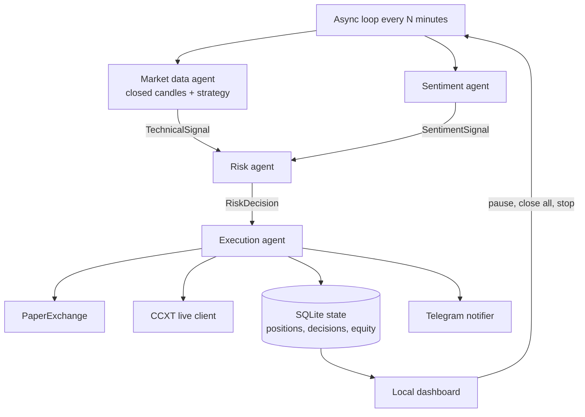

# Crypto trading bot

Four small agents share one async loop: market data, sentiment, risk, and execution. The default process is a **paper trader** with a **local web dashboard**. It will not send an exchange order unless you turn paper mode off and set a second confirmation flag. A **historical backtester** with benchmarks tells you whether a strategy is worth running at all.

Hebrew quick start: [README.he.md](README.he.md). What changed in 1.1: [CHANGELOG.md](CHANGELOG.md).

**This is not financial advice.** Cryptocurrency trading can lose some or all of the capital you commit. Indicators lag. Headlines are noisy. Stops slip. Exchange outages happen. Neither bundled strategy has a demonstrated edge. Run the backtest and paper mode until you understand every order the bot wants to send. Use trade-only API keys with withdrawals disabled. Never point this at money you cannot afford to lose.

## Quick start

Python 3.11 or newer.

```bash
python -m venv .venv
source .venv/bin/activate            # Windows: .venv\Scripts\activate
pip install -r requirements.txt -r requirements-dev.txt
cp .env.example .env

python main.py backtest --strategy all   # 1. is there any edge? (downloads ~3 years of candles once)
python scripts/demo_dashboard.py         # 2. look at the dashboard with fake data
python main.py                           # 3. paper trade; open http://127.0.0.1:8765
```

## Architecture



Each cycle:

1. Fetch candles for every symbol concurrently. **Drop the candle that is still forming** and score only closed bars, so a signal cannot flip inside a bar.
2. Mark open positions. Paper mode checks stops and targets against the current price *and* the high/low of bars since entry. Live mode reads the state of the real stop orders on the exchange.
3. Roll the UTC day (daily loss breaker) and update the equity peak (max-drawdown kill switch).
4. Score Fear & Greed plus headlines once for the whole book. If both sources fail, sentiment is NEUTRAL.
5. Let the risk agent accept or reject each symbol. Every decision, including "no action" and why, is stored.
6. Save an equity snapshot and write `data/heartbeat`.

### Strategies

| `STRATEGY` | Idea | Notes |
| --- | --- | --- |
| `trend` (default) | Long when the close breaks the 20-bar high while EMA50 > EMA200 and price > EMA200. Exit when the close breaks the 10-bar low. Shorts mirror it when allowed. | One philosophy: follow trends, cut losers with the ATR stop, let the exit channel trail winners. Best on 4h or 1d. |
| `legacy` | The original weighted mix: RSI 0.30, MACD 0.25, SMA 0.20, Bollinger 0.15, EMA 0.10. | Kept for comparison. Mean-reversion and trend components fight each other, and the EMA component is the sign of the MACD line, counted twice. |

### Sentiment

Fear & Greed maps 0 → −1 and 100 → +1. Headlines use a visible keyword list, counted per distinct headline. A negating verb ("delays", "rejects", "denies", ...) turns that headline's bullish hits bearish. Fear & Greed updates once a day and headlines are market-wide, so treat this agent as a brake, not as edge. Agreement can raise technical confidence by up to 15%, disagreement can cut it by up to 40%, and strong opposite sentiment (≥ 0.50) vetoes an entry. Exits ignore sentiment.

### Risk and sizing

```text
risk_budget   = equity * RISK_PER_TRADE      # default 1%
stop_distance = ATR * ATR_MULTIPLIER         # or price * FIXED_STOP_PCT
size          = risk_budget / stop_distance
```

The size is then capped by cash, by `MAX_NOTIONAL_PCT` per position (default 50% of equity) and by `MAX_TOTAL_EXPOSURE_PCT` across all open positions (default 100%). BTC and ETH move together, so two "independent" full-size positions would be one bet. When a cap binds the real risk is below the target; the decision text always reports the **effective** risk as a percentage of equity.

Reward:risk is checked **after** fees and slippage on both legs. With a 1% stop and 0.1% fees per side a nominal 2R trade is about 1.5R; `MIN_REWARD_RISK` now rejects trades that only look good before costs.

Gates on new entries (exits are never blocked): operator pause, max-drawdown kill switch (`MAX_DRAWDOWN_PCT` from the equity peak, stays on until reset in the dashboard), daily loss (`DAILY_MAX_LOSS_PCT`, resets each UTC day), cooldown after a stop-out, max positions, confidence floor, sentiment veto.

## Dashboard

`python main.py` serves http://127.0.0.1:8765 (Hebrew by default, English toggle, light and dark). It shows equity and today's PnL, drawdown against the daily limit and the kill switch, exposure, open positions with distance to stop and target, whether each stop lives on the exchange, the latest signal per symbol with its reasoning, every risk decision with the reason, closed trades, warnings, and the equity curve.

Buttons: **pause entries**, **resume**, **run a cycle now**, **reset the kill switch**, **close all positions**, **stop the bot**. Destructive actions ask for confirmation.

Security: binds to 127.0.0.1 by default. A non-loopback bind (Docker) refuses to start without `DASHBOARD_TOKEN`. POSTs need a custom header a foreign web page cannot send, and loopback binds reject foreign `Host` headers (DNS rebinding). `python scripts/demo_dashboard.py` shows the page with fake data.

## Backtest

```bash
python main.py backtest                                   # .env symbols, timeframe and strategy, last 3 years
python main.py backtest --strategy all --since 2021-01-01
python main.py backtest --symbols BTC/USDT --timeframe 1d --fear-greed
python main.py backtest --csv candles.csv --symbols BTC/USDT
```

* Same `Strategy` and `RiskManager` code as live, same `OHLCV_LIMIT` sliding window.
* No look-ahead: decisions at a bar's close fill at the **next bar's open**, plus slippage and fees. Stops and targets are checked on each bar's high/low; a bar that touches both is counted as a stop.
* Benchmarks: **buy and hold**, and **random entries** (200 runs by default) with the same sizing, stops, targets, fees and holding times. If the strategy does not beat roughly the 95th percentile of random entries, its entries add nothing over chance.
* Metrics: total return, CAGR, max drawdown, Sharpe, Sortino, Calmar, trades, win rate, profit factor, expectancy in R, holding time, time in market, fees.
* Consecutive out-of-sample periods with fixed parameters (`--folds`, default 4) show whether results come from one lucky regime.
* `--fear-greed` replays the sentiment veto with the daily Fear & Greed history (yesterday's value, to avoid look-ahead). Headlines have no history and are not simulated.
* Candles are cached in `data/history/`. A self-contained HTML report goes to `reports/`.

## Layout

```text
main.py                     loop, dashboard, reconciliation, `backtest` subcommand
config/settings.py          pydantic-settings, hard limits, live-trading gate
agents/strategies.py        trend and legacy strategies (closed bars only)
agents/market_data.py       candles, closed-candle filter, TechnicalSignal
agents/sentiment.py         Fear & Greed, RSS/CryptoPanic, lexicon with negation
agents/risk.py              sizing, caps, net R:R, gates
agents/execution.py         PaperExchange and live CCXT execution
core/state.py               SQLite: account, positions, decisions, equity, events
core/orchestrator.py        one isolated cycle
core/control.py             runtime status and operator controls
core/redact.py              secret masking for logs, Telegram and the dashboard
core/timeframes.py          timeframe math and the closed-candle split
core/healthcheck.py         Docker health check from the heartbeat file
dashboard/                  stdlib HTTP server and the single-page UI
backtest/                   data download/cache, engine, benchmarks, HTML report
scripts/demo_dashboard.py   dashboard preview with fake data
scripts/backtest_lite.py    offline synthetic smoke test
tests/                      pytest suite
```

## Configuration

All names match `.env.example`. Percentages are fractions: `0.01` is 1%. Invalid or dangerous values stop the process at startup with a list of what to fix.

| Variable | Default | Role |
| --- | --- | --- |
| `PAPER_TRADING` | `true` | Paper simulator. Live orders are impossible while this is true. |
| `LIVE_TRADING_CONFIRM` | `false` | Second lock. Required together with paper mode off. |
| `EXCHANGE_ID` | `binance` | `binance` or `bybit`. |
| `MARKET_TYPE` | `spot` | `swap` is required for live shorts. |
| `LEVERAGE` | `1` | Swap only (1–10). Set on the exchange at startup with isolated margin. |
| `EXCHANGE_SANDBOX` | `false` | CCXT sandbox / testnet when the exchange supports it. |
| `STRATEGY` | `trend` | `trend` or `legacy`. |
| `SYMBOLS` | `BTC/USDT,ETH/USDT` | Comma-separated CCXT symbols. |
| `TIMEFRAME` | `4h` | Candle timeframe. |
| `LOOP_INTERVAL_MINUTES` | `15` | Time between cycles (stops and exits are checked each cycle). |
| `OHLCV_LIMIT` | `300` | Sliding window of closed candles. `trend` needs ≥ 212. |
| `RISK_PER_TRADE` | `0.01` | Equity fraction lost if the stop fills at its price. Max 0.05. |
| `REWARD_RISK_RATIO` | `3` | Take-profit distance divided by stop distance. |
| `MIN_REWARD_RISK` | `1.5` | Minimum R:R after fees and slippage. |
| `MIN_CONFIDENCE` | `0.55` | Minimum combined confidence. |
| `MAX_OPEN_POSITIONS` | `3` | Includes resting limit orders. |
| `MAX_NOTIONAL_PCT` | `0.5` | Cap on one position's notional vs equity. |
| `MAX_TOTAL_EXPOSURE_PCT` | `1` | Cap on all open notional vs equity. |
| `DAILY_MAX_LOSS_PCT` | `0.05` | Blocks entries for the rest of the UTC day. |
| `MAX_DRAWDOWN_PCT` | `0.20` | Kill switch from the equity peak. Manual reset. |
| `COOLDOWN_MINUTES` | `60` | Per symbol, after a stop-out. |
| `USE_ATR_STOPS` / `ATR_MULTIPLIER` | `true` / `2.5` | Stop distance = ATR × multiplier. |
| `FIXED_STOP_PCT` | `0.03` | Used when ATR stops are off or ATR is zero. |
| `ALLOW_SHORT` | `false` | Paper can simulate shorts. Live shorts also need `MARKET_TYPE=swap`. |
| `ORDER_TYPE` | `market` | `market` or `limit`. Exits are always market. |
| `PENDING_ORDER_TTL_MINUTES` | `60` | Unfilled limit entries are cancelled after this. |
| `FEE_RATE` / `SLIPPAGE_PCT` | `0.001` / `0.0005` | Used by paper, sizing and the backtest. |
| `STARTING_BALANCE` | `10000` | Paper cash, and the live baseline until the first balance sync. |
| `DASHBOARD_ENABLED` / `HOST` / `PORT` / `TOKEN` | `true` / `127.0.0.1` / `8765` / empty | Local dashboard. Token required off loopback. |
| `TELEGRAM_BOT_TOKEN` / `TELEGRAM_CHAT_ID` | empty | Both needed for alerts. |
| `CRYPTOPANIC_TOKEN` | empty | Optional. RSS is the fallback. |
| `CLIENT_ORDER_PREFIX` | `ctb` | Prefix of every `clientOrderId`, used to find orphan orders. |

## Live trading: how orders are handled

* **Idempotent orders.** Every order carries a `clientOrderId`. After a timeout the bot looks the order up by that id before retrying, so a lost response cannot cause a double entry.
* **Exchange-side stop from the real fill.** After an entry fills, a separate stop order is placed at the planned distance from the actual average fill price (CCXT unified `stopLossPrice`, then `triggerPrice`, then a stop-limit). Its id is stored.
* **Take-profit.** On swap, a reduce-only take-profit order is placed too. On spot the bot manages the target itself, because a second sell order would lock the same coins and be rejected.
* **Cancel before close.** Every close cancels the stored protective orders first, so no orphan stop can hit a later position. On spot the bot sells what the account holds (exchanges often take the buy fee in the coin).
* **Real exit prices.** When the exchange stop fires, PnL uses that order's fill price.
* **Backstops.** No stop accepted → software stop every cycle (and a warning in the dashboard). Price beyond a protected stop for two checks in a row → market close.
* **Startup reconciliation.** Local positions are compared with the exchange: positions closed while offline are recorded, missing stops are re-placed, orphan orders with the bot's prefix are cancelled.
* **Limit entries** expire after `PENDING_ORDER_TTL_MINUTES`; partial fills are adopted and protected.

Order types and parameters differ per exchange and change between CCXT versions. **Run the full flow on the exchange testnet (`EXCHANGE_SANDBOX=true`) and confirm in the exchange UI that a stop order appears after each entry before you go live.**

## Switching to live

1. Run `python main.py backtest --strategy all` and read the verdict honestly.
2. Paper trade for weeks. Check the dashboard's decision log.
3. Create a **new** API key that can trade and cannot withdraw. Restrict it by IP if possible. A dedicated sub-account is the safe setup, because the spot position check assumes the bot is the only holder of each base coin.
4. Use the testnet first: `EXCHANGE_SANDBOX=true`, fresh data dir: `DATA_DIR=data/live`.
5. Keep size small: lower `RISK_PER_TRADE` and `MAX_NOTIONAL_PCT`.
6. Set **both** `PAPER_TRADING=false` and `LIVE_TRADING_CONFIRM=true`, plus `EXCHANGE_API_KEY` and `EXCHANGE_API_SECRET`.
7. Start and read the log. It must say `LIVE TRADING ENABLED`. Reconciliation findings are logged, sent to Telegram and shown in the dashboard.
8. Stop with the dashboard button, Ctrl+C, `SIGTERM` or `docker compose stop`. The current step finishes and exchange stops stay in place.

## Docker

```bash
cp .env.example .env        # set DASHBOARD_TOKEN to a long random string
docker compose up -d --build
docker compose logs -f
```

The dashboard is published on `127.0.0.1:8765` only. The container has a health check based on the heartbeat file and restarts unless stopped. `data/`, `logs/` and `reports/` stay on the host.

## Tests

```bash
pytest
```

Covered: indicators, both strategies, closed-candle handling, sizing caps and net R:R, gates (pause, kill switch, daily loss, cooldown), paper fills with slippage, wick stops and limit expiry, SQLite migration and swap accounting, secret redaction, sentiment negation, live execution against a stateful fake exchange (lost responses, stop placement and fallback, cancel-before-close, exchange stop fills, spot take-profit, backstop, reconciliation, orphan cleanup, limit expiry, swap leverage), the dashboard HTTP API and its security checks, and the backtest's timing rules and benchmarks.

For reproducible installs, pin exact versions with `pip freeze > requirements.lock` (or `pip-compile`) once a working set is installed.
